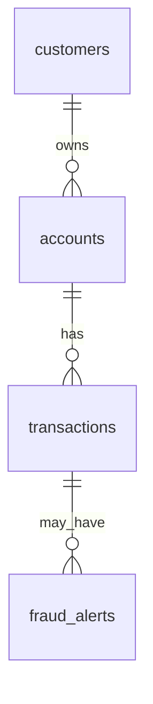

# LumaPay Fintech SQL Practice

A beginner-friendly MySQL project using a fictional fintech dataset. The queries explore transaction outcomes, connect transactions to customer accounts, and review related fraud alerts.

All records are synthetic and were created for practice. They do not describe real people, accounts, payments, or fraud cases.

## Dataset

| Table | Rows | Contents |
| --- | ---: | --- |
| `customers` | 300 | Customer names, email addresses, countries, and identity verification statuses |
| `accounts` | 600 | Customer accounts, account types, statuses, and balances |
| `transactions` | 12,000 | Payments and transfers, including amount, date, channel, and status |
| `fraud_alerts` | 500 | Alerts linked to transactions, including reason, severity, and review status |

### Transaction results

The transaction status query returns these totals:

| Status | Transactions |
| --- | ---: |
| Successful | 6,880 |
| Failed | 1,678 |
| Pending | 1,743 |
| Reversed | 1,699 |
| **Total** | **12,000** |

There are 5,120 transactions that are not successful: failed, pending, or reversed. Pending transactions have not reached a final outcome; reversed transactions were later undone.

## Table relationships

- `customers.customer_id` connects a customer to their accounts.
- `accounts.account_id` connects an account to its transactions.
- `transactions.transaction_id` connects a transaction to any related fraud alerts.

## Files

- `data/lumapay_mysql_import.sql` creates the `lumapay_practice` database, its tables, and the dataset.
- `sql/01_transaction_outcomes.sql` counts transactions by status and shows examples of successful, non-successful, and failed transactions.
- `sql/02_customers_with_unsuccessful_transactions.sql` shows customers and accounts connected to non-successful transactions.
- `sql/03_transactions_and_fraud_alerts.sql` shows transactions with fraud alerts, transactions without alerts, and open or investigating alerts.
- `sql/04_more_quality_checks.sql` contains checks for transaction channels, high-value amounts, repeated transaction identifiers, and open fraud alerts.
- `docs/manual_test_cases.md` contains practice checks and expected results for the SQL queries.
- `docs/bug_report_template.md` is a template for recording a test finding.

## Import the dataset with MySQL Workbench

1. Open MySQL Workbench and connect to your local MySQL Server.
2. Select **File → Open SQL Script** and open `data/lumapay_mysql_import.sql`.
3. Click the lightning-bolt **Run** button.
4. Confirm the import results show 300 customers, 600 accounts, 12,000 transactions, and 500 fraud alerts.
5. Open a query file from the `sql` folder and click **Run** to explore the data.

The import creates a separate database named `lumapay_practice`. It uses `INSERT IGNORE`, so rows with existing primary key values are skipped if you run the import again. Run the query files separately from the import file.

## SQL topics practiced

- Counting and grouping transaction statuses.
- Filtering by transaction outcome.
- Joining customers, accounts, transactions, and fraud alerts.
- Finding transactions without a related fraud alert.
- Sorting results and limiting output to manageable samples.
